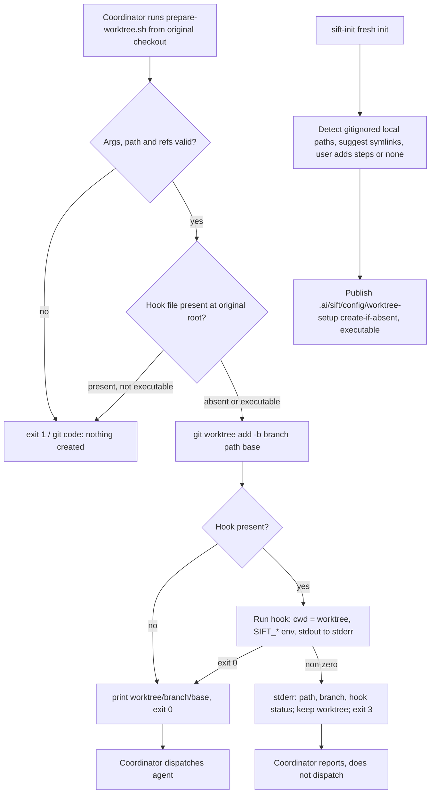
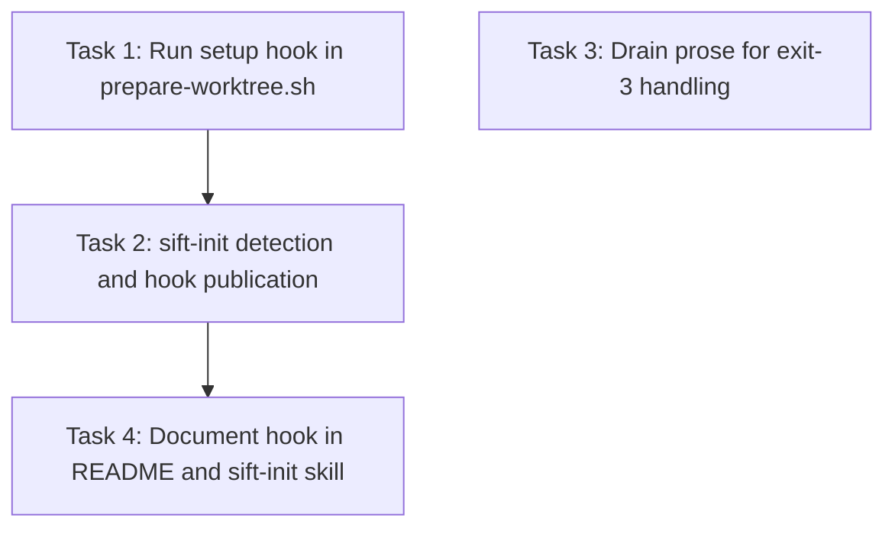

# Plan: Project-Owned Worktree Setup Hook

## Original Work Order

> Work order for GitHub issue e0ipso/sift#4 "Allow projects to customize worktree setup" (https://github.com/e0ipso/sift/issues/4).
>
> Objective: let a consuming repository define an optional, project-owned setup hook that Sift Drain runs inside every freshly prepared worktree (implementation sittings, wave-gate agents, code-review worktree) before an agent is dispatched into it. With no hook configured, behaviour stays byte-identical to today.
>
> Scope (in):
> - Hook resolution and execution in src/skills/sift-drain/scripts/prepare-worktree.sh (currently 23 lines: usage `<base-branch> <new-branch> <absolute-new-path>`, refuses relative/existing paths with exit 1, resolves `COMMIT=$(git rev-parse --verify "$BASE^{commit}")`, runs `git worktree add -b`, prints `worktree=`/`branch=`/`base=` key lines on stdout). The hook runs after `git worktree add`, with cwd = the new worktree, and receives a documented context: original repo root, new worktree path, branch, resolved base commit (suggested env names following the SIFT_* convention: SIFT_ROOT for the original root since lib.sh already treats it as the tracker root, plus e.g. SIFT_WORKTREE, SIFT_BRANCH, SIFT_BASE_COMMIT).
> - Hook stdout must not pollute the parsed key lines (route to stderr or a log). Setup failure gets a distinct exit code that does not clash with exit 1 (refusal, nothing created) or git's pass-through codes, keeps the worktree and branch in place, and prints the worktree path, branch and hook exit status on stderr.
> - Documentation of the configuration convention plus a practical example in README.md `## Configuration` (README.md is the normative spec and ships as .ai/sift/README.md; re-sync src/skills/sift-init/assets/README.md via src/skills/sift-init/scripts/sync-assets.sh; guarded by tests/scripts/convention-assets.test.sh and sync-assets.test.sh). Document the boundaries: the hook must not write to the integration checkout or the shared tracker (.ai/sift); hooks may run concurrently across parallel sittings/gates; a failed worktree is preserved for inspection and never reset or cleaned; re-preparing an existing path is still refused.
> - Prose updates for coordinator behaviour on setup failure (stop dispatch into that worktree, report it, preserve the worktree): src/skills/sift-drain/SKILL.md (usage at :82, implementation sittings :111-114, gate worktrees :155), references/run-management.md:42-46, references/wave-gate.md:7, references/code-review.md:16-17 (decide whether a review-worktree setup failure records the review stage as skipped, consistent with existing code-review failure handling). Keep the existing SIFT_ROOT / never-symlink-.ai/sift arrangement intact.
> - Tests in tests/scripts/prepare-worktree.test.sh (harness helpers in tests/lib/harness.sh: run_cmd, newdir, tree_digest, assert_*): (1) no hook configured → identical output/behaviour; (2) successful hook → records pwd and the context env into a file outside the repo, asserts cwd is the worktree, values are correct, integration branch/HEAD and `tree_digest` of .ai unchanged; (3) failing hook → distinct non-zero exit, worktree and branch preserved, clear stderr.
> - Commit message notes "Migration: none" (the key/hook is optional), matching commit 75101cc's precedent.
>
> Scope (out): teardown hooks; sandboxing/enforcing the tracker boundary; per-role hooks (one hook for all three worktree kinds); changing tests/benchmarks/drain-cache-run.py (it calls the script directly at :208 and must keep working unchanged when no hook is configured); changing sift-init's generated config.yaml beyond at most a commented example.
>
> Context and constraints:
> - AGENTS.md portability rules apply to shipped scripts and README fenced blocks: bash plus standard Unix tools; no `sed -i`, no `xargs -r`, `[[:space:]]` in awk; no yq/jq dependency. Guarded by tests/static/portability.test.sh and shell-lint.test.sh.
> - Existing config precedent: `.ai/sift/config/config.yaml` holds `prefix:` (parsed by scripts in lib.sh:55-59 via portable sed, overridable by SIFT_PREFIX) and the optional `code_review:` block (enabled/command/model, read by the orchestrator agent from prose, not by a script; README documents YAML quoting for `command`).
> - `.ai/sift/` is commonly gitignored in consuming repos (this repo's .ai/sift/.gitignore is `*`), so a hook stored under .ai/sift is local to one checkout and absent from new worktrees; resolve it from the original root (git toplevel or SIFT_ROOT), not cwd.
> - Other prose guards: tests/static/skill-prose-pins.test.sh, tests/static/gate-agent-ownership.test.sh (gate fences must keep "Use the prepared worktree"), tests/static/prompt-readme-sections.test.sh (`## Configuration` is not an @README-SECTION name, so adding prose there is safe; do not rename headings).
> - tests/run.sh is the full verification command.
>
> Design decisions to settle in the clarification loop:
> 1. Configuration shape: a `config.yaml` key (e.g. `worktree_setup: <command>` run via `sh -c`, first script-parsed key besides `prefix`) versus a fixed executable path (local `.ai/sift/config/worktree-setup` or a tracked project path).
> 2. Which copy runs: the original checkout's hook or the new worktree's copy at the base commit (reproducibility vs. an agent branch being able to alter it).
> 3. The setup-failure exit code value.
>
> Success criteria: no-hook behaviour and output unchanged; hook runs in the new worktree with the documented context before any dispatch for all three worktree kinds; failure stops dispatch, preserves the worktree, and is reported clearly; integration checkout and tracker untouched by Sift's own preparation logic; README + asset mirror document the convention with an example and boundaries; the three new prepare-worktree test cases pass; tests/run.sh passes.

## Plan Clarifications

| Question | Answer |
|---|---|
| How does a consuming repo configure the hook? | A fixed executable at `.ai/sift/config/worktree-setup`. In addition, sift-init must ask how worktrees are set up when the prefix is chosen and suggest steps such as symlinking environment files or Kenkeep's local state. |
| How does the sift-init question work? | Init detects gitignored local paths a fresh worktree would lack (e.g. `.env`, `.env.local`, `.ai/kenkeep/_sessions`) and suggests symlinking them from the original root. The user picks, edits or adds steps, such as a dependency install, or chooses none. Init writes the hook from the result. "None" writes no hook. |
| Which copy of the hook runs? | Always the coordinator's checkout copy, resolved from the original root, even when a project tracks `.ai/sift` and each worktree also has a copy at the base commit. |
| What exit code signals hook failure? | `3`. The hook's own status is printed on stderr, not passed through. |
| Is backwards compatibility required, and do existing repos get the question? | With no hook, behaviour is unchanged and no migration is needed. Only fresh initialization asks the question. Already-initialized repos add the hook by hand, following the README. |

## Executive Summary

Sift Drain hands every agent an isolated worktree made by `prepare-worktree.sh`. Today that script only creates a branch at the resolved base commit. Projects that need dependencies installed, local configuration linked in or files generated have no supported place to do it, so agents start in worktrees that cannot run the project's checks.

This plan adds one optional, project-owned executable, `.ai/sift/config/worktree-setup`. `prepare-worktree.sh` runs it right after creating any worktree, with cwd set to the new worktree and a small `SIFT_*` environment that describes it. A failure is reported with its own exit code, `3`. The worktree is kept for inspection, and the drain coordinator does not dispatch into it. With no hook present, the script behaves exactly as it does now.

A fixed path was chosen over a `config.yaml` key so shipped scripts never parse YAML scalars or quoting. It also sits next to the existing configuration and works when `.ai/sift` is gitignored. sift-init gains a question at fresh initialization: it inspects the repository for gitignored local state, proposes symlinks and lets the user add commands, then writes the hook. Most projects get a working hook without reading the spec, and the README documents the interface and boundaries for everyone else.

## Context

### Current State vs Target State

| Current State | Target State | Why? |
|---|---|---|
| `prepare-worktree.sh` creates the branch and worktree and stops | It runs `.ai/sift/config/worktree-setup` from the original root after creation, when that file exists | Agents need a worktree that can run the project's tooling before dispatch |
| No defined context for project setup | The hook runs with cwd set to the new worktree and gets `SIFT_ROOT`, `SIFT_WORKTREE`, `SIFT_BRANCH` and `SIFT_BASE_COMMIT` | A documented interface lets hooks link or copy from the original checkout without guessing |
| Exit 1 for refusals; git codes pass through | Exit 3 means "worktree created, setup failed, worktree kept". A non-executable hook file is refused with exit 1 before anything is created | Callers must be able to tell "nothing was created" from "created but not ready" |
| Drain prose assumes preparation always yields a usable worktree | SKILL.md, run-management, wave-gate and code-review say what to do on exit 3: no dispatch, report, keep the worktree | Without this, setup failures stop being visible once the coordinator has dispatched |
| sift-init asks only for the prefix and milestone | Fresh init also asks how worktrees are set up, suggests symlinks for detected gitignored paths, and writes the hook | Most projects need the same few steps; asking at init makes the hook the default rather than a hidden feature |
| README `## Configuration` covers `prefix` and `code_review` | It also documents the hook path, environment, exit code, boundaries and an example | README is the normative, shipped spec |

### Background

- `.ai/sift` is gitignored by default (`*` with `!.gitignore`), and worktrees never get a symlinked `.ai/sift`. A hook stored there exists only in the coordinator's checkout, which is why it is resolved from the original root. The same rule applies to repositories that opt into tracking the tree, so there is one rule with no ambiguity.
- Shipped scripts follow `SIFT_*` naming (`SIFT_ROOT`, `SIFT_PREFIX`). `lib.sh` already treats `SIFT_ROOT` as the tracker root, so the hook receives it with that same meaning.
- The `code_review:` block is read by the orchestrator from prose, and `prefix:` is the only key a script parses. The hook adds no new script-parsed YAML.
- `tests/benchmarks/drain-cache-run.py` calls `prepare-worktree.sh` directly. It must keep working unchanged because it configures no hook.
- sift-init's gate also uses exit code 3, for `UNINITIALIZED`. That belongs to a different script and does not conflict, but the README must state that the hook exit code is specific to `prepare-worktree.sh`.

## Architectural Approach

### Hook execution in prepare-worktree.sh

**Objective**: Run the project's setup in every newly prepared worktree, with a stable interface and no change when no hook exists.

- **Resolving the original root.** The original root is the git toplevel of the directory the script runs from: the coordinator's checkout. The hook path is `<original root>/.ai/sift/config/worktree-setup`, and the cwd-relative or worktree-local copy is never used.
- **Validation before creation.** The executable check joins the existing argument, path and ref checks, so a non-executable hook file is refused with exit 1 before `git worktree add`. A missing file means "no hook".
- **Running the hook.** After `git worktree add` succeeds, the hook runs directly, so the project chooses its interpreter with a shebang. Cwd is the new worktree. It gets `SIFT_ROOT` (original root), `SIFT_WORKTREE`, `SIFT_BRANCH` and `SIFT_BASE_COMMIT` (the resolved SHA). Its stdout is redirected to stderr so the stdout key lines stay parseable.
- **Outcomes.**
  - On success, the script prints the same `worktree=`/`branch=`/`base=` lines as today and exits 0.
  - On failure, it prints a clear stderr diagnostic naming the worktree path, the branch and the hook's exit status, exits 3, and leaves the worktree and branch in place.
  - With no hook, both output and exit status are unchanged.
- **Out of scope.** Sift's own logic still writes nothing to the integration checkout or the tracker. It does not sandbox the hook.

### Drain coordinator prose

**Objective**: Make every dispatch path treat exit 3 as "do not dispatch, report, keep the worktree".

- Update the usage line and implementation-sitting steps in `src/skills/sift-drain/SKILL.md` (around :82 and :111-114) and the gate worktree note (:155).
- Update `references/run-management.md` (the central preparation and reuse rules at :42-46). A failed worktree is never reset, cleaned or reused. A retry uses a fresh path and branch.
- Update `references/wave-gate.md:7`. Keep the "Use the prepared worktree" phrase in gate fences, because `gate-agent-ownership.test.sh` pins it.
- Update `references/code-review.md:16-17`. When the review worktree's setup fails, the review stage follows the existing code-review failure handling in that reference rather than inventing a new state.
- Keep the shared-tracker arrangement unchanged: `SIFT_ROOT` points at the original root, and `.ai/sift` is never symlinked.

### sift-init worktree setup question

**Objective**: Offer a working hook during fresh initialization, based on what the repository actually ignores.

- **When it runs.** The question is asked in sift-init's input step, after the prefix is confirmed, and only for fresh initialization: the `UNINITIALIZED` paths. The `INCOMPLETE` repair and `READY` paths never ask.
- **Detection.** A deterministic `sift-init.sh` mode lists candidate gitignored paths at the root using git's own ignore resolution, such as `.env*` files and local tool state like `.ai/kenkeep/_sessions`. It always excludes `.ai/sift` and Sift's own paths.
- **The question.** The skill presents the candidates as suggested symlinks from `SIFT_ROOT`. The user can deselect them, add custom commands such as a dependency install, or choose none.
- **Publishing the hook.** A deterministic `sift-init.sh` option writes `.ai/sift/config/worktree-setup` with the executable bit set. It uses the existing create-if-absent publication path, so an existing hook is always kept and concurrent runs stay safe. "None" writes nothing.
- **The generated hook.** It is a plain bash script that uses only the documented `SIFT_*` variables. Its symlink steps skip any source missing from `SIFT_ROOT` rather than failing, and the comments name each step's origin.

### Specification and tests

**Objective**: Document the convention as public API and guard each behaviour with a test.

- **README.md `## Configuration`.** Document:
  - the hook path and the fact that it is resolved from the original root;
  - the executable requirement;
  - the cwd and the four `SIFT_*` variables;
  - stdout going to stderr;
  - exit 3 and the kept worktree;
  - the boundaries: never write `.ai/sift` or the integration checkout through the hook; symlinked paths are shared writable state across worktrees; hooks may run concurrently; a failed worktree is kept for inspection, never reset or cleaned; re-preparing an existing path is still refused;
  - an example that symlinks `.env` and runs a dependency install.

  No heading is renamed. Re-sync `src/skills/sift-init/assets/README.md` with `sync-assets.sh`.
- **`tests/scripts/prepare-worktree.test.sh`.** Add four cases:
  - no hook: output identical to today;
  - successful hook: it records `pwd` and the environment to a file outside the repo; the test asserts the values, that the integration branch and HEAD are unchanged, and that the `tree_digest` of `.ai` is unchanged;
  - failing hook: exit 3, worktree and branch exist, stderr names path, branch and status, stdout has no key lines;
  - non-executable hook: exit 1 and no worktree or branch created.
- **sift-init tests**, in the existing `tests/scripts/sift-init-*.test.sh` family:
  - detection lists ignored candidates and excludes `.ai/sift`;
  - publication creates an executable hook, keeps an existing one, and writes nothing for "none";
  - a published hook runs successfully through `prepare-worktree.sh` against a fixture.
- **Portability and lint.** All new shell and README fenced blocks follow the AGENTS.md portability rules and pass `portability.test.sh` and `shell-lint.test.sh`.

## Risk Considerations and Mitigation Strategies

Technical Risks

- **Hook output corrupts parsed key lines**: callers read `worktree=`/`branch=`/`base=` from stdout.
    - **Mitigation**: redirect hook stdout to stderr and print key lines only on success. A test asserts no key lines on failure.
- **Original root resolved wrongly when run from a subdirectory**: a cwd-relative lookup would miss the hook.
    - **Mitigation**: resolve through the git toplevel, and test from a subdirectory of the original checkout.
- **Detection output varies across git versions or BSD/GNU userlands**: ignored-path listing differs in trailing slashes and ordering.
    - **Mitigation**: use plain `git ls-files` ignore flags, normalize and `sort -u` the output, and run it under the existing portability harness.

Implementation Risks

- **Symlinks write through to the original checkout**: a symlinked directory makes agent writes land in the coordinator's checkout, and `.ai/sift` must never be linked.
    - **Mitigation**: detection excludes `.ai/sift`. The README states that symlinked paths are shared writable state and that the tracker must never be linked.
- **Concurrent hooks contend on shared caches or ports**: parallel sittings and gates prepare several worktrees at once.
    - **Mitigation**: document concurrency in the README. Sift adds no locking, which is out of scope.
- **Prose guards break**: changes to the drain references may trip `skill-prose-pins`, `gate-agent-ownership` or `prompt-readme-sections`.
    - **Mitigation**: keep pinned phrases and headings, and run `tests/run.sh` before completion.

## Success Criteria

### Primary Success Criteria

1. With no hook, `prepare-worktree.sh` produces the same stdout, stderr shape and exit status as before, and the benchmark harness runs unchanged.
2. With an executable hook, the hook runs once per prepared worktree, with cwd set to that worktree and correct `SIFT_ROOT`, `SIFT_WORKTREE`, `SIFT_BRANCH` and `SIFT_BASE_COMMIT`. The integration branch, its HEAD and the `.ai` tree digest stay unchanged.
3. A failing hook yields exit 3 with a diagnostic naming the path, branch and status, and the worktree and branch remain. A non-executable hook yields exit 1 with nothing created.
4. Drain prose for implementation, wave-gate and review worktrees instructs no dispatch on exit 3, a report, and preservation of the worktree.
5. Fresh sift-init asks the worktree question after the prefix, suggests detected ignored paths without `.ai/sift`, and writes an executable hook, or none when chosen. Existing hooks are never overwritten, and repair/READY runs never ask.
6. README `## Configuration` and its shipped mirror document the hook, its interface, exit code, boundaries and an example. `tests/run.sh` passes.

## Self Validation

1. Run `tests/run.sh` and confirm a zero exit. Check that its summary lists no new skipped checks or narrowed portability cases.
2. In a scratch git repository with an initialized `.ai/sift`:
   - Run `prepare-worktree.sh main w1 <abs path>` with no hook. Diff its stdout against a run of the pre-change script from `git show main:src/skills/sift-drain/scripts/prepare-worktree.sh`.
   - Add an executable hook that writes `pwd` and the four `SIFT_*` variables to a file in `mktemp -d`. Prepare a second worktree and confirm the values.
   - Confirm `git -C <original> rev-parse --abbrev-ref HEAD` and `git -C <original> status --porcelain` are unchanged.
3. Make the hook `exit 7`, prepare a third worktree, and confirm:
   - exit status 3;
   - stderr names the path, branch and status 7;
   - `git worktree list` shows the worktree;
   - `git branch --list` shows the branch;
   - stdout has no `worktree=` line.
4. Run `chmod -x` on the hook, prepare a fourth worktree, and confirm exit 1, with no new worktree or branch.
5. In a fresh scratch repository with `.env` and `.env.local` gitignored:
   - Run the new sift-init detection mode and confirm both appear and `.ai/sift` does not.
   - Publish a hook from those selections and confirm it is executable.
   - Re-run publication and confirm the file is kept byte-identical.
   - Prepare a worktree and confirm `.env` in it is a symlink into the original root.
6. Run `cmp README.md src/skills/sift-init/assets/README.md` and confirm it reports no difference.
7. Grep the four drain prose files for the exit-3 handling and confirm each one states no dispatch, a report, and a kept worktree.

## Documentation

- **README.md** (normative spec) and its shipped mirror `src/skills/sift-init/assets/README.md` need the new `## Configuration` content described above.
- **`src/skills/sift-drain/SKILL.md`** and the three drain references need the exit-3 handling.
- **`src/skills/sift-init/SKILL.md`** needs the new question in its input step, the new `sift-init.sh` modes, the created-entries list (the hook appears only when chosen), and the report fields.
- **AGENTS.md** needs no update. The change adds no cross-skill rule copy, renames no README `##` heading, and changes no repository contract. The `## Configuration` section is not an `@README-SECTION` name.
- **The commit message** states "Migration: none".

## Resource Requirements

### Development Skills

- Portable bash across GNU and BSD userlands, and git worktree and ignore semantics.
- Familiarity with the sift-drain coordinator prose and the sift-init deterministic gate and publication flow.

### Technical Infrastructure

- bash, git and standard Unix tools only. No new dependencies.
- The existing test harness in `tests/lib/harness.sh` and `tests/run.sh`, including shellcheck when available.

## Integration Strategy

The hook sits entirely inside `prepare-worktree.sh`, so every caller gets it with no call-site changes: implementation sittings, gate agents, the review worktree and the benchmark. The drain prose only adds handling for the new exit status. The sift-init additions are confined to fresh initialization and reuse its existing create-if-absent publication, so repair and READY flows are untouched.

## Notes

- Existing installations add the hook by hand by following the README. No migration recipe is needed because the file is optional and absent by default.
- A retry after exit 3 always prepares a fresh path and branch. The failed worktree stays until a human inspects and removes it.

## Task Dependencies

## Execution Blueprint

**Validation Gates:**
- Reference: `/config/hooks/POST_PHASE.md`

### ✅ Phase 1: Hook execution and coordinator prose
**Parallel Tasks:**
- ✔️ Task 1: Run the project worktree setup hook in prepare-worktree.sh
- ✔️ Task 3: Document exit-3 setup-failure handling in the drain coordinator prose

### ✅ Phase 2: sift-init hook generation
**Parallel Tasks:**
- ✔️ Task 2: Add worktree-setup detection and hook publication to sift-init.sh (depends on: 1)

### ✅ Phase 3: Specification
**Parallel Tasks:**
- ✔️ Task 4: Document the worktree setup hook in README.md and the sift-init skill (depends on: 2)

### Post-phase Actions

### Execution Summary
- Total Phases: 3
- Total Tasks: 4
