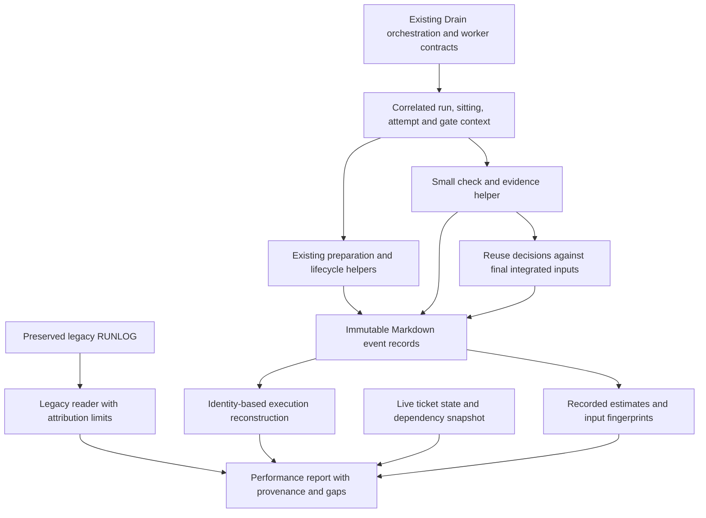
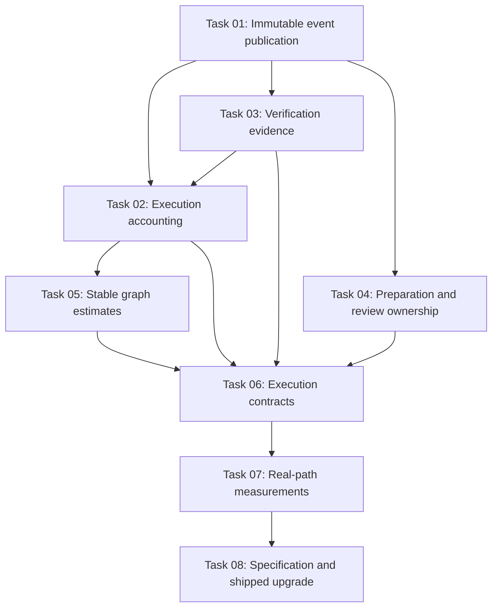

# Plan: Execution throughput and performance observability

## Original Work Order

> $fix-remote-issue 7

Issue #7, "Improve execution throughput and concurrency-safe performance observability": https://github.com/e0ipso/sift/issues/7

The fetched issue is the work order for this plan, reproduced without changes:

> ## Motivation
>
> Improve execution throughput and performance observability for every project using Sift. The motivating failure pattern is slower ticket completion as work shifts into serial verification, infrastructure repair and repeated handoffs. Existing timing cannot reliably separate implementation, waiting, verification and rework. Investigate and improve the actual execution path while preserving the optimizations already present.
>
> The current report has a concrete concurrency defect: it maintains one open dispatch group, treats a new dispatch epoch as an incomplete previous group, and records ticketless phase events. Independent dispatches within the same second also merge into one apparent group. A worker return precedes landing and integrated verification, so its reported `done` is insufficient evidence of verified delivery.
>
> Existing measurements reinforce the need for better attribution, rather than proving the motivating slowdown's cause. The prompt-caching experiment explicitly serialized workers, used its driver's monotonic elapsed time instead of RUNLOG estimates, and documented unmatched-group diagnostics after delayed return stamping. It observed longer elapsed time in one small cohort, but did not establish a causal performance regression.
>
> ## Proposed Solution
>
> ### 1. Make execution timing correct under concurrency
>
> Introduce stable run, wave, sitting, ticket and attempt identities and optional external task identifiers. Define their relationships and persistence across retries, interruptions and resumes. Represent grouped-ticket membership explicitly; independent sittings must remain distinct even when timestamps match. A retry must identify its originating attempt while preserving completed members of a partially successful group.
>
> Record structured append-only events with timestamps and durations. Reconstruct overlapping attempts by identity rather than a single current dispatch or adjacency. Handle concurrent writers and first-log creation without truncation, lost records or interleaved partial records. Retain interrupted and incomplete attempts, orphan events and missing terminal evidence as explicit observations. Legitimate overlap must not be diagnosed as corruption; invalid timestamps and malformed records still need useful diagnostics.
>
> Retain a documented reader or migration path for existing six-column RUNLOG data. Label legacy timing and unrecoverable attribution explicitly. Do not fabricate historical worker, attempt or gate identities that the old records cannot establish. Keep ticket front-matter authoritative; the event log remains diagnostic evidence.
>
> ### 2. Separate useful work, waiting and rework
>
> Capture spans for workspace preparation, orientation, implementation, verification, review, landing and cleanup. The existing `implement` phase spans ticket implementation, scoped checks and commits, so merely renaming the four current phases will not provide this separation. Record waits with reasons covering dependencies, write ownership, resource admission, provider limits and user input. Keep external blockers distinct from agent-actionable work.
>
> Record wave-gate work even without an implementation ticket, including gate attempts and repairs. Link failures, retries and generated follow-up tickets to the originating attempt or gate. Record product delivery separately from infrastructure/tooling repair, and development separately from explicitly deferred compatibility work. Define those classifications using supported project configuration or explicit metadata; avoid guessing from a ticket's category alone.
>
> Emit events automatically from existing helpers wherever feasible, including workspace/setup failures before dispatch. Pass correlation context through the current helpers and handoffs. Keep any necessary worker reporting small and explicit. Record instrumentation gaps rather than inferring activities from silence. Avoid repeated manual bookkeeping and a heavyweight monitoring framework.
>
> ### 3. Report honest throughput and ETA ranges
>
> Report verified ticket completions separately from superseded, cancelled or otherwise non-delivery outcomes. Respect current ticket lifecycle names, including `wontfix`, unless an explicit schema migration is justified. Deduplicate delivery across retries. Show implementation landed separately from wave verification completed. Neither a successful worker return nor a deferred compatibility check counts as full verification.
>
> Report elapsed throughput, attempt durations, retry rate, waiting time and gate duration with clear denominators, observation windows and provenance. Include incomplete attempts and missing evidence in the report. Show concurrent effort separately from elapsed wall time; never present the sum of overlapping durations as wall-clock runtime. Shared sitting/gate work must not be charged once per member ticket.
>
> Build ETA ranges from recent observed comparable performance and the remaining dependency graph, including write-ownership constraints and observed available concurrency. Include gate and retry costs once. Separate external-blocker uncertainty from agent-actionable work and disclose sparse samples or unavailable evidence. Preserve an estimate's origin and assumptions: after its lower bound passes, mark that fact and revise only for changed observations or scope. Do not slide an unchanged estimate forward on every report.
>
> ### 4. Reduce avoidable verification and coordination work
>
> Audit the worker and wave-gate contracts together for duplicate checks, unchanged context reads, redundant coverage audits and unnecessary handoffs. Preserve scoped verification during implementation and integrated verification at the appropriate gate. Existing e2e authoring, batch coverage, root-cause repair and close stages can each require broad reruns; resolve overlapping obligations through explicit evidence ownership and invalidation rules.
>
> Reuse passing evidence only when relevant source inputs, dependencies, tests, commands, test configuration and required platform/environment inputs match. An unchanged commit hash alone is not sufficient, and a new commit alone need not invalidate identical relevant inputs. Retain the producing attempt, command, exit status and evidence location, and record why each check was reused or invalidated. Missing fingerprints or unavailable evidence require an explicit conservative decision. Preserve full verification after relevant changes and ensure the final integrated state is covered.
>
> Batch related repairs before an expensive integrated rerun when correctness permits, while retaining root-cause grouping and write ownership. Carry preserved work, relevant failure evidence and reusable checks into retries. Preserve the current partial-group retry policy and separate ticket commits.
>
> Use existing project extension points where practical for platform matrices and development-versus-compatibility stages, including the configuration and worktree-setup hook. Any deferral must carry explicit authorization, scope and a recorded outstanding obligation. Report deferred checks separately; never silently convert a missing platform or deferred check into a pass.
>
> ### 5. Validate the actual execution path
>
> Extend deterministic tests around the real helpers and report generation, rather than implementing a second model of the intended algorithm. Cover interleaved workers, grouped tickets with mixed outcomes, same-second independent dispatches, concurrent first writes, retries, crashes, interruptions/resumes, orphan events, missing terminal events, superseded/non-delivery outcomes and legacy attribution.
>
> Exercise evidence reuse and invalidation for unchanged versus changed relevant inputs, changed test configuration and final integration. Include gate-only activity, linked follow-ups, waiting reasons, ETA graph effects, missing evidence and an unchanged estimate whose lower bound has passed. Use controlled input timestamps for exact arithmetic and schedule-independent invariants for concurrent writers. Avoid brittle wall-clock assertions.
>
> Add small execution fixtures that invoke the real workspace, logging, verification and reporting path. Measure instrumentation overhead and verification/coordination reductions using reproducible event, command, read or operation counts, plus observational elapsed measurements where useful. State what those fixtures exercise and what still depends on agent adherence. Keep optional provider experiments separate from portable deterministic fixtures; do not infer production throughput or token savings from read-volume reductions.
>
> ### Completion criteria
>
> - [ ] Distinct overlapping attempts and same-second sittings reconstruct correctly; retries and resumes retain correlation and shared work is counted once.
> - [ ] Append-only writes survive concurrency and missing terminal events without losing earlier evidence or treating valid overlap as corruption.
> - [ ] Spans, waits, gate-only work, failures and follow-up provenance are emitted through the actual helpers/contracts with documented blind spots.
> - [ ] Reports distinguish verified delivery, non-delivery outcomes, infrastructure repair, landing, wave verification and authorized compatibility deferral, and disclose incomplete/missing evidence.
> - [ ] Throughput and ETA fixtures prove elapsed accounting, dependency/concurrency constraints, external blockers, single-counted gate/retry costs and stable estimate origins.
> - [ ] Passing checks are reused only with matching relevant inputs/configuration; reuse and invalidation reasons are recorded and final integration remains verified.
> - [ ] The audit preserves existing context-read, prompt, sitting and scoped-verification optimizations while reducing demonstrably redundant work.
> - [ ] Legacy RUNLOG fixtures remain readable with unrecoverable historical attribution explicitly labelled.
> - [ ] Small real-path execution fixtures document overhead, measured improvements and limits without brittle timing thresholds or provider assumptions.
> - [ ] Documentation and examples describe identities, event/report semantics, evidence reuse, retries, configuration and compatibility. Any layout/key rename includes a runnable portable migration recipe; update shipped assets and prompt pins together.
> - [ ] `tests/run.sh` passes with skips and portability narrowing reported.
>
> ### Portability and scope
>
> Keep this a small coherent implementation within Sift's existing conventions: filesystem state, Bash, standard Unix tools and portable awk. Do not require an installable runtime, monitoring framework, daemon, database or another controller layer. Guard optional conveniences such as Python, jq and xmllint. Follow GNU/BSD recipe rules, including no `sed -i` or `xargs -r`. Introduce no Android-specific behavior, machine-specific concurrency limits, provider-specific assumptions or dependency on a particular orchestration application. External task IDs are optional correlation data.
>
> ## Additional Context
>
> ### Investigation and canonical sources
>
> Investigated the working tree at commit `38358fd19ae3b4f462d5689d5bfbc0a65f093229`. The following links pin the inspected execution implementation.
>
> - [README.md:250](https://github.com/e0ipso/sift/blob/38358fd19ae3b4f462d5689d5bfbc0a65f093229/README.md#L250) defines RUNLOG's six-column public format. Its Configuration and Updating installed copies sections define project extension points and refresh behavior. README headings are parsed API.
> - [src/skills/sift-drain/SKILL.md](https://github.com/e0ipso/sift/blob/38358fd19ae3b4f462d5689d5bfbc0a65f093229/src/skills/sift-drain/SKILL.md) owns dispatch, retries, landing and gate order. [src/skills/sift-drain/references/run-management.md](https://github.com/e0ipso/sift/blob/38358fd19ae3b4f462d5689d5bfbc0a65f093229/src/skills/sift-drain/references/run-management.md) owns dependency/write-ownership edges, snapshot reconciliation and user reporting; it already excludes superseded archives from implementation completion.
> - [src/skills/sift-drain/scripts/drain-log.sh:188](https://github.com/e0ipso/sift/blob/38358fd19ae3b4f462d5689d5bfbc0a65f093229/src/skills/sift-drain/scripts/drain-log.sh#L188) closes the single open group when a new dispatch epoch appears. The same helper is the sole log writer and reporter. Its `ensure_log` and per-row append path also need concurrent-write coverage.
> - [src/skills/sift-drain/references/ticket-agent-prompt.md:59](https://github.com/e0ipso/sift/blob/38358fd19ae3b4f462d5689d5bfbc0a65f093229/src/skills/sift-drain/references/ticket-agent-prompt.md#L59) stamps phases without worker identity. Steps 3c and 4 already distinguish ticket-scoped checks, single-ticket evidence reuse and a grouped sitting's final union check. The retry template already carries failure reports and preserves tickets completed earlier in a sitting.
> - [src/skills/sift-drain/references/wave-gate.md:37](https://github.com/e0ipso/sift/blob/38358fd19ae3b4f462d5689d5bfbc0a65f093229/src/skills/sift-drain/references/wave-gate.md#L37), its batch coverage/root-cause/close sections, and [src/skills/sift-drain/references/code-review.md](https://github.com/e0ipso/sift/blob/38358fd19ae3b4f462d5689d5bfbc0a65f093229/src/skills/sift-drain/references/code-review.md) define the serial gate stages, broad runs, root-cause repair and independent review. Batch coverage explicitly says not to add a fresh coverage audit.
> - [src/skills/sift-drain/scripts/prepare-worktree.sh](https://github.com/e0ipso/sift/blob/38358fd19ae3b4f462d5689d5bfbc0a65f093229/src/skills/sift-drain/scripts/prepare-worktree.sh) creates isolated worktrees and runs the project-owned setup hook. Dispatch is stamped after preparation, so setup cost and hook failures currently fall outside attempt runtime. Preserve the hook's kept-worktree failure behavior and ownership limits.
> - `read-context.sh` and `ticket-snapshot.sh` under the same scripts directory already provide bounded reads and checksum deltas. Preserve fingerprint-based instruction reuse, context-loss recovery, fixed contract prefixes with trailing assignments, related worker reuse within a wave, dependency/write-scope scheduling, separate ticket commits and wave-level test authoring.
>
> ### Generated and installed copies
>
> Edit canonical Drain files under `src/skills/sift-drain/`; `.agents/skills/sift-drain` is a symlink to that directory. There is no separate `.cursor/skills/sift-drain` copy in this checkout. The normative README, `schemas/` and `src/operations/sift.sh` have shipped copies under `src/skills/sift-init/assets/`. Regenerate those with `src/skills/sift-init/scripts/sync-assets.sh` when affected, rather than hand-copying. Installed projects refresh assets through the documented sift-init path, which preserves existing config and logs. Document any instrumentation schema upgrade separately.
>
> `AGENTS.md` inventories shared ID validation/allocation copies and prohibits force-adding this repository's ignored tracker. Preserve those agreements if IDs or allocation change. Never reset, clean or check out live ignored tracker state.
>
> ### Reproduction through real helpers
>
> A disposable Sift tree with prefix SFT and a deterministic `date` shim was used to call the unmodified `drain-log.sh` writer and report. No sleeps or simulated reporter were used. The injected epoch sequence was:
>
> ```text
> 1000 dispatch SFT-0001
> 1001 phase orient
> 1010 dispatch SFT-0002
> 1012 phase implement
> 1020 return SFT-0001 done
> 1030 return SFT-0002 done
> ```
>
> The report marks SFT-0001 INCOMPLETE, then its return ORPHAN, and counts only SFT-0002 as resolved, although both writer calls returned successfully. In a second fixture, separate dispatch calls for SFT-0001 and SFT-0002 both at epoch 1000, with returns at 1020 and 1030, produce one apparent two-ticket group. Stable explicit identities must fix both cases.
>
> The existing `bash tests/scripts/drain-log.test.sh` passed during investigation: 49 cases, 308 assertions, zero failures or skips. This is a baseline for current serial semantics, not evidence that concurrency works. No implementation changes are part of filing this issue.
>
> ### Tests and documentation to extend
>
> - [tests/scripts/drain-log.test.sh](https://github.com/e0ipso/sift/blob/38358fd19ae3b4f462d5689d5bfbc0a65f093229/tests/scripts/drain-log.test.sh) owns writer/report CLI and arithmetic fixtures. [tests/scripts/prepare-worktree.test.sh](https://github.com/e0ipso/sift/blob/38358fd19ae3b4f462d5689d5bfbc0a65f093229/tests/scripts/prepare-worktree.test.sh) covers setup and failure behavior; [tests/scripts/context-reads.test.sh](https://github.com/e0ipso/sift/blob/38358fd19ae3b4f462d5689d5bfbc0a65f093229/tests/scripts/context-reads.test.sh) covers reader/delta behavior. [tests/e2e/drain-wave.test.sh](https://github.com/e0ipso/sift/blob/38358fd19ae3b4f462d5689d5bfbc0a65f093229/tests/e2e/drain-wave.test.sh) exercises real dispatch, return, tracker operations and the read-volume benchmark.
> - Static guards include `prompt-workflow-order.test.sh`, `skill-prose-pins.test.sh`, `prompt-readme-sections.test.sh`, `gate-agent-ownership.test.sh`, `convention-assets.test.sh`, `agents-skill-copies.test.sh` and portability checks. Extend owning tests and update changed document pins rather than weakening them.
> - [tests/README.md](https://github.com/e0ipso/sift/blob/38358fd19ae3b4f462d5689d5bfbc0a65f093229/tests/README.md) defines real-helper testing, disposable fixtures, interleaving-independent assertions and optional portability members. `tests/run.sh` is the whole verification command.
> - [docs/drain-context-measurement.md](https://github.com/e0ipso/sift/blob/38358fd19ae3b4f462d5689d5bfbc0a65f093229/docs/drain-context-measurement.md) documents the existing reduced-read optimization and its shell-trace limits. [docs/drain-prompt-caching.md:256](https://github.com/e0ipso/sift/blob/38358fd19ae3b4f462d5689d5bfbc0a65f093229/docs/drain-prompt-caching.md#L256) records unmatched timing diagnostics; its earlier reproduction section explicitly serializes worker trials. Existing `tests/benchmarks/drain-context.sh` and optional cache/usage experiment scripts are useful starting points, but neither their read metrics nor serialized cache experiments establish concurrent throughput. Preserve historical results and distinguish new measurements.
>
> Related completed extension work: #2 introduced optional code review and #4 introduced project-owned worktree setup. Reuse those extension points where practical.
>

## Plan Clarifications

| Question | Answer |
|---|---|
| Approve writing the Strikethroo plan for issue #7 with this design: immutable Markdown events alongside a legacy RUNLOG reader; correlated attempts, spans and waits; input-matched verification evidence reuse; concurrency-aware throughput and ETA reports; portable real-helper tests and documentation? This step creates the plan only; implementation is a later workflow stage. | Approve this plan scope |
| Is backwards compatibility required? | Yes. The issue explicitly requires a migration or reader path for existing RUNLOG data and explicit labels for unrecoverable historical attribution. Preserve the existing six-column log bytes and provide that reader. No additional historical attribution is promised. |
| Does this approval include implementation? | No. The approved step creates this plan only. Task generation and implementation are later workflow stages. |

## Executive Summary

Sift needs timing that remains correct when workers overlap and when a sitting crosses
dispatch, retry, landing and verification boundaries. This plan replaces timestamp-based
dispatch-group inference for new executions with explicit identities and immutable Markdown
events. Existing RUNLOG data remains readable as limited historical evidence. Ticket files
continue to own status; diagnostic records explain execution and verification.

The same small instrumentation path supports useful-work spans, waits, gate-only activity,
failure provenance and verification evidence. A command wrapper captures checks and their
inputs so the worker and gate contracts can avoid redundant execution when evidence still
matches. Final integrated verification remains an explicit obligation. Reports distinguish
elapsed time from concurrent effort, delivery from infrastructure repair, and development
verification from authorized compatibility deferral. ETA ranges retain their original
observation time and show uncertainty from external blockers separately.

The implementation belongs in the existing Drain helpers, prompts and specification. It
does not introduce a scheduler, monitoring service, mandatory language runtime or provider
integration. Deterministic fixtures exercise the actual helpers and reporter, while small
execution fixtures measure instrumentation operations and check reductions. Those results
must state the remaining limits of prompt-driven execution and portable clocks.

## Context

### Current State vs Target State

| Current state | Target state | Why the change is necessary |
|---|---|---|
| One open group closes when another dispatch epoch appears | Explicit run, wave, sitting and attempt relationships reconstruct overlapping work | Valid overlap currently becomes incomplete/orphan output |
| Separate calls in the same second become one group | Timestamp-independent identities preserve each sitting | Clock resolution must not define membership |
| Four ticketless phases mix implementation, checks and bookkeeping | Attributed spans separate preparation, orientation, implementation, verification, review, landing and cleanup | Current phase totals cannot identify the source of delay |
| Setup failures and gate-only work sit outside dispatch timing | Attempts exist before preparation, and gates have their own attempts | Missing work distorts throughput and retry costs |
| A returned done status precedes integration | Return, landing and applicable integrated verification remain distinct observations | Worker success alone does not prove delivery |
| Broad checks appear in several gate roles | Each required check has an owner and evidence with explicit reuse/invalidation decisions | Repeated checks can consume elapsed time without adding evidence |
| Completion counts include bookkeeping outcomes | Verified delivery, resolved backlog and non-delivery outcomes have separate denominators | Superseded or wontfix archives must not inflate product throughput |
| Timing supports serial runtime summaries | Reports include elapsed throughput, attempts, waits, retries, gates and dependency-aware ETA ranges | Summed concurrent durations and sliding estimates mislead |
| Historical experiments measure reads or serialized model runs | New fixtures measure actual helper execution with bounded claims | Existing experiments do not establish concurrent production throughput |

### Background

Investigation covered the live implementation at commit
`38358fd19ae3b4f462d5689d5bfbc0a65f093229`, the issue's real-helper reproductions and
an independent read-only research brief. The concurrency defect is established. The broader
cause of slower delivery is still a hypothesis to measure.

The canonical implementation and documentation owners are:

- `README.md:233` defines the six-column RUNLOG public API. Its Configuration section
  defines project configuration and the worktree setup hook; its installed-copy section
  defines refresh behavior.
- `src/skills/sift-drain/scripts/drain-log.sh:64` contains lazy log creation and row
  appends. At line 188 its reader closes one current group when the epoch changes.
- `src/skills/sift-drain/SKILL.md:92` owns scheduling and handoffs. At line 130 a worker
  return is logged before cherry-picking and archival. Its gate contract owns final
  integrated verification.
- `references/run-management.md` under that skill owns dependency and write-scope edges,
  snapshot reconciliation, worker check-back and reporting.
- `references/ticket-agent-prompt.md` owns the sole full worker contract and report schema.
  Steps 3c and 4 already provide scoped checks, single-ticket evidence reuse and the
  grouped sitting's final union check.
- `references/wave-gate.md` and `references/code-review.md` own gate obligations,
  root-cause repair, review isolation and tracker snapshot protection.
- `scripts/prepare-worktree.sh` owns preparation and setup-hook failures.
  `scripts/read-context.sh` and `scripts/ticket-snapshot.sh` own bounded reading and
  content/path deltas.

These paths are relative to `src/skills/sift-drain/` where abbreviated.
`.agents/skills/sift-drain` is a symlink to that canonical skill. There is no independent
Cursor Drain copy in this checkout. The normative README, schemas and operations script
have generated assets under `src/skills/sift-init/assets/`, maintained by
`src/skills/sift-init/scripts/sync-assets.sh`.

Existing optimizations remain requirements: live snapshot reconciliation, in-flight ownership
retention, bounded reads, lazy reference loading, instruction fingerprints, context-loss
recovery, fixed worker prefixes with trailing assignments, related-worker reuse within a
wave, cluster bounds, priority/dependency scheduling, one commit per ticket, partial-group
retries, scoped verification, deferred test authoring, root-cause repair grouping and one
knowledge-capture pass per wave.

Historical plans 2 and 3 explain earlier timing and batching choices. They are context,
not current source authority, and this plan does not reopen or rewrite them. Some knowledge
nodes retain obsolete ROADMAP and roadmap-check references. The live path uses ticket
`wave:` metadata and `ticket-check.sh`.

The existing `docs/drain-context-measurement.md` records reduced shell read volume.
`docs/drain-prompt-caching.md` documents serialized worker trials and unmatched RUNLOG
diagnostics. Preserve those observations and their limits; no causal throughput benefit is
inferred from them.

## Architectural Approach



### Immutable events and stable identity

**Objective:** Preserve execution evidence under overlapping writers without treating
timestamps, file adjacency or one mutable current-group variable as identity.

Use an additive diagnostic tree at `.ai/sift/runs/<run-id>/`. Its event records live at
`events/<event-id>/event.md`. A producer reserves a unique directory with the portable
`mktemp -d` pattern, writes and validates its record privately in that directory, and
publishes it with a same-directory rename to the final name. The directory is exclusively
owned by that producer. Published records are never rewritten or replaced.

This avoids a global append lock, first-header race and shared sequence. The public
`drain-log.sh` entry point remains responsible for publication and reporting; small internal
modules may keep its parsing and arithmetic readable. Existing ticket-ID allocation and
its cross-skill copies remain unchanged.

Define a versioned, flat Markdown/front-matter record grammar that portable shell and awk
can validate. Document field encoding, required fields, unknown-version handling and
rejection before publication. Do not require a general YAML/JSON parser. Records carry
event identity, actor, timestamp, correlation references and applicable outcome, span,
duration, classification, reason or evidence references. Validate membership and field
values before publication. Equal timestamps and zero-length spans are valid.

Persist the run before preparation begins. A run survives explicit interruption and resume.
A wave execution identifies a particular run's traversal of the existing numeric ticket
wave; late work on a closed wave follows the existing tail rule. A sitting identifies the
original ordered group. Each attempt records its explicit ticket subset and may refer to
a prior attempt through a retry relationship. Gates have stable identities and their own
attempts even when they contain no implementation ticket. Ticket events carry immutable
ticket IDs, and external task identifiers remain optional opaque metadata.

Resuming the same still-identifiable execution retains its attempt and opens new spans.
Redispatching or restarting execution creates a new linked attempt. Never silently resume
a terminal attempt or assume an old process still exists. Narrow retries to failed or
unstarted members and preserve prior members' landed work and evidence.

Pair spans and outcomes by identity and relationships. Duplicate publication of the same
semantic event must not double-count activity; conflicting repetitions or terminal outcomes
produce a visible diagnostic and cannot establish success. Unknown references, invalid
timestamps, incomplete publications and missing terminals remain visible. A directory
without its final record is incomplete publication, never a completed event. Process-crash
preservation is required; power-loss durability beyond available filesystem guarantees is
not claimed.

Reports read an observed set of published immutable records without changing it. Publication
during a scan can leave a temporarily missing cross-reference; label that observation and
allow a later report to resolve it. Rendering order may be deterministic, but ordering must
not determine parentage or group membership.

Keep `RUNLOG.md` unchanged and implement a legacy reader for its existing six-column
format. Historical groups are inferred evidence, not newly recovered attempts. Explicitly
mark unavailable worker, attempt, gate and phase attribution and ambiguous same-second or
overlapping groups. Historical done rows are reported outcomes, not verified delivery.
The additive layout needs no destructive conversion; the documented upgrade and reader
path must work without rewriting history.

### Activity, waiting and provenance

**Objective:** Attribute preparation, implementation, checking and coordination without
adding a repeated manual log-writing routine.

Carry run, wave, sitting and attempt context through fresh assignments, retained-worker
assignments, retries and all gate prompts. Keep changing identities after the fixed-contract
boundary so prefix stability survives. Activity events belong to the current execution
actor, including coordinator-owned work. Workers invoke helpers; they never edit records
by hand.

Preparation instrumentation begins before `prepare-worktree.sh` can reject arguments,
encounter Git errors or run the setup hook. Preserve its stdout contract, exit behavior,
hook environment, isolated worktree model and kept-worktree failure semantics. Automatic
instrumentation is opt-in through correlation context so standalone existing helper use
remains supported. Verify this boundary rather than disguising setup failures as dispatches.

Capture explicit spans for workspace preparation, orientation, implementation, verification,
review, landing and cleanup. Verification includes checks currently executed inside
implementation step 3c, so four renamed phase stamps are insufficient. Record helper-driven
boundaries automatically. Retain a small number of explicit worker transitions for reasoning
and work outside commands; do not claim to observe unreported model activity.

Waits carry start/end identity, a controlled reason and external versus agent-actionable
classification. Required reasons are dependencies, write ownership, resource admission,
provider limits and user input. Retain the blocker reference where known. Unknown intervals
remain unattributed, and provider waits require no provider adapter.

Represent gates, review attempts, root-cause repairs and failed setups without fabricating
implementation tickets. Link failures and generated follow-up tickets to their originating
attempt or gate, affected members and root cause. Product delivery, infrastructure/tooling
repair and unknown work are explicit classifications; do not infer them solely from ticket
category. Record development and compatibility verification stages separately.

Define diagnostic write ownership during review. The existing whole-tracker snapshot would
otherwise flag legitimate telemetry as reviewer tamper. Account narrowly for authorized
diagnostic publication while retaining detection of reviewer changes to tickets, config,
reservation marks, legacy logs and unrelated existing records. The reviewer must not obtain
blanket permission to modify diagnostic history. Test both allowed publication and forbidden
tracker mutation.

### Verification evidence and gate ownership

**Objective:** Avoid duplicate execution while keeping the required final integrated state
covered by applicable passing evidence.

Add a small shell command/evidence helper alongside Drain's scripts. It executes the
project command with preserved argument boundaries and exit status, captures raw logs outside
the checkout, records start/end events, and publishes the evidence manifest. It is not a
general build cache, command scheduler or replacement for project test tooling.

A check identity includes its required scope and verification stage, exact command and
arguments, logical working directory, producing attempt, platform/environment identity,
result and evidence location. Input manifests cover relevant source, dependency, test,
fixture and configuration files, discovered file membership, executable modes and symlink
identities/targets where applicable. Git content identities can fingerprint files without
adding a language runtime. Dynamic state needs an explicit project stamp; a worktree path
or commit ID alone is insufficient.

Collect inputs before and after execution. A changing input set, missing evidence, unavailable
logs, unknown dependencies or uncertain environment state prevents reuse and records the
reason. Reuse is permitted across new commits or prepared worktrees when all relevant
identities match. Reuse is denied within an unchanged commit when relevant untracked,
configuration or platform state changed. Do not use saved orientation checksums as proof of
complete verification inputs.

Use a small optional verification section in the existing project configuration to describe
required checks, platform/stage scope and input/environment declarations. Keep its accepted
syntax bounded and documented for the existing shell parser. The existing worktree setup
hook prepares project environments and can establish declared environment identity. Projects
without complete declarations continue discovering their commands and running conservative
checks; evidence completeness is a prerequisite for reuse, not for using Sift.

Assign one owner per required integrated check. Specialists run focused checks while
authoring and repairing tests. Passing broad evidence may satisfy a later role's obligation
only after the helper checks matching relevant inputs. Batch independent repairs before an
expensive final rerun when dependencies and write ownership permit. Preserve per-root-cause
repair ownership, existing assertion standards and separate ticket commits.

At close, evaluate all required evidence against the final integrated state. Run every
missing or invalidated check and retain why any passing result was reused. No blanket
skip follows from an earlier green worker or gate. A retry receives preserved work,
failure provenance and still-valid evidence instead of paying for unchanged checks again.

Platform matrices and development-versus-compatibility obligations are project-specific.
Compatibility deferral must identify explicit authorization, scope, reason and outstanding
obligation. Authorization may be a relevant user directive or explicit project policy;
silence is not authorization. A development pass with deferred compatibility remains
separate from complete verification.

### Throughput and ETA reporting

**Objective:** Report useful delivery and elapsed cost with explicit evidence and assumptions.

Keep backlog resolution, worker-reported done, landed implementation, development-verified
delivery and fully wave-verified delivery distinct. Full verified delivery requires
authoritative done ticket state, landing evidence and applicable passing final integrated
checks. Deduplicate ticket delivery across attempts. Wontfix, superseded and cancelled
execution outcomes contribute no delivered ticket; retain current ticket lifecycle names.
Existing wave advancement may still depend on resolved backlog and must not be silently
redefined by performance reporting.

Show elapsed run/wave time and elapsed throughput with the exact observation window and
denominator. Report attempt-duration distributions, retry counts/rates, waits by reason,
gate durations and missing/incomplete evidence. Keep infrastructure/tooling repair apart
from product delivery, with an unknown category when classification is absent.

Report summed concurrent effort as a different quantity from elapsed time. Parent attempt
envelopes, child spans and check spans must not be added together. Group-level shared work
and wave gates are counted once, not once per ticket. Union overlapping intervals when
presenting aggregate occupied time; retain waiting and unclassified gaps separately.
Incomplete attempts contribute disclosed observed/lower-bound activity and missing-terminal
counts, not fabricated completion times or zero-cost samples.

ETA consumes a recorded snapshot of remaining ticket dependencies, write-ownership edges,
verification obligations and observed admission capacity. It does not introduce a second
scheduler. The coordinator supplies ownership edges it already derives from citations;
a report with missing graph evidence discloses the limitation. Maximum observed overlap is
used concurrency, not proof of spare available capacity.

Use a bounded recent cohort of comparable completed observations, with classification,
group size, stage and environment assumptions visible. Compute scenario ranges for remaining
work under graph constraints and recorded slot/admission evidence. Include gate and retry
cost once: either use retry-inclusive comparable samples or add separately modeled retries.
Treat shared gates as wave obligations, and distinguish known outstanding repairs from
uncertain future retry allowance.

Persist estimate-origin events with absolute bounds, graph/input fingerprints, sample
references and assumptions. Ordinary reports render those estimates read-only. When an
unchanged estimate's lower bound has passed, label it passed rather than resetting the
clock. Revise only for changed evidence or scope, retaining the prior estimate and revision
reason. External blockers have separately stated uncertainty; absent release evidence
must not become an invented unblock date. Sparse samples may yield labelled scenarios or
an unavailable estimate rather than unsupported confidence.

### Real execution fixtures and measurement

**Objective:** Prove the implementation path and disclose what deterministic tests cannot prove.

Extend `tests/scripts/drain-log.test.sh` for the public writer/reader/reporter.
Use the existing preparation, context-read and `tests/e2e/drain-wave.test.sh` owners for
their boundaries. New helper behavior can have its own owning script case when needed.
Documentation extraction in `tests/lib/recipes.sh` must be updated deliberately with
the Run log section; neither empty extraction nor obsolete pins may make coverage vacuous.

Use controlled timestamp inputs for exact arithmetic. Exercise interleaved records and
same-second independent sittings, mixed grouped outcomes, narrowed retries, interruption and
resume, gate-only work, follow-up links, crashes before publication, missing terminals,
orphans, conflicting events and explicitly limited legacy data. Launch real concurrent
writers and assert preservation, uniqueness and valid published records under every
interleaving. Do not force schedules with sleep or FIFO barriers.

Drive the real evidence helper with disposable commands and declared manifests. Verify
reuse across identical inputs despite new commits and invalidation for source, dependency,
test configuration, environment/platform, discovered membership, symlink/mode or evidence
availability changes. Mutate inputs during a check and demonstrate that its result is
ineligible for reuse. Confirm final integration rejects mismatched worker evidence.

Small disposable execution fixtures prepare real worktrees and setup hooks, perform scripted
worker actions, run real checks, record retries and gates, and invoke the real reporter.
Compare equivalent verification obligations before and after reuse, counting executed
commands and publication operations. Keep the existing context-read benchmark as a separate
preservation check. Observational elapsed figures may supplement counts without brittle
performance thresholds.

Record all required checks, skip reasons, introduced instrumentation operations and measured
reductions. State that fixtures exercise helper wiring and scripted transitions, while
autonomous worker adherence, provider scheduling and representative production throughput
remain unmeasured unless a separate experiment establishes them.

## Risk Considerations and Mitigation Strategies

<details>
<summary>Technical Risks</summary>

- Publication can be interrupted. Exclusive event directories and final-name publication
  preserve prior records and make incomplete publication observable. Never recover by
  overwriting a published record.
- Portable epoch seconds are coarse and not monotonic. Preserve equal timestamps and
  disclose clock limitations; reject invalid negative intervals instead of treating overlap
  as corruption.
- Relevant test inputs can be incomplete or externally mutable. Require a complete declared
  manifest and before/after identity checks for reuse; otherwise run the required command.
- Concurrent publication can expose temporarily unresolved references. Report observed
  evidence and gaps, and reconstruct by stable identity on the next scan.
- Diagnostics can resemble reviewer tamper. Narrow the snapshot adjustment to authorized
  publication and prove that ticket, config and historical-record mutations still fail.
- Large histories can make repeated parsing costly. Scan only requested runs and retain
  bounded recent cohorts for ETA; measure fixture operation counts before claiming low
  overhead. No indexing service is introduced.

</details>

<details>
<summary>Implementation Risks</summary>

- Instrumentation can become manual overhead. Automate helper and command boundaries and
  retain only essential explicit activity transitions in worker contracts.
- New evidence rules can accidentally weaken gate coverage. Require a final integrated
  manifest match for every reused obligation and retain nonzero failures.
- Classification or deferral can inflate delivery. Keep unknown work explicit and require
  authorization for compatibility deferral; neither is a full pass.
- Prompt and generated-copy drift can split behavior. Update canonical owners, fixed-prefix
  pins, schema extractors and affected shipped assets together.
- Existing dirty files and ignored live tickets can be lost through recovery commands.
  Limit this planning change to its new directory and preserve all preexisting edits.
  Implementation must never reset, clean or check out live ignored tracker state.

</details>

<details>
<summary>Measurement Risks</summary>

- Smaller read volume or fewer commands may not improve delivery latency. Report each
  measured quantity separately, preserve historical limits and avoid causal claims beyond
  the actual fixture.
- Sparse or unrepresentative samples can produce misleading ETAs. Expose cohort selection,
  assumptions, missing graph evidence and external blockers, and allow unavailable ranges.
- A passing scripted fixture cannot prove worker adherence. Keep this blind spot explicit
  and test published command contracts as well as helper behavior.

</details>

## Success Criteria

### Primary Success Criteria

1. Distinct overlapping attempts and same-second sittings reconstruct correctly, including
   explicit grouped membership, retries and resumes, with shared work counted once.
2. Concurrent first and later publications preserve all complete events. Crashes,
   incomplete publication, malformed/orphan records and missing terminals remain visible
   without corrupting earlier evidence or misclassifying legitimate overlap.
3. The actual helpers and contracts emit attributed activity, waits, gate-only work,
   setup failures, retry/follow-up links, landing and cleanup evidence with documented gaps.
4. Reports distinguish authoritative ticket outcomes, returned work, landing, verified
   product delivery, infrastructure repair, authorized compatibility deferral and complete
   wave verification. Non-delivery outcomes never inflate delivery counts.
5. Elapsed throughput, attempt durations, retry rate, waiting and gate cost have explicit
   windows and denominators. Parent/child or concurrent durations are not double-counted.
6. ETA fixtures demonstrate graph, ownership and capacity constraints, separate external
   blocker uncertainty, single-counted gate/retry costs and stable estimate origins after
   lower bounds pass.
7. Check reuse requires matching relevant inputs, commands, configuration, platform and
   available evidence, records its decision and reason, and covers the final integrated
   state. Input changes during a check prevent reuse.
8. Existing context-read, prefix, worker-reuse, scheduling, scoped-verification, grouped
   retry, separate-commit and gate-level authoring optimizations remain protected.
9. Existing six-column RUNLOG data remains readable without rewriting it. Unrecoverable
   historical attribution and unavailable verification evidence are explicitly labelled.
10. Small real-path fixtures show instrumentation cost and any verification/coordination
    reductions using reproducible counts, with observational timing and blind spots clearly
    separated. No material-overhead claim rests on a brittle timing threshold.
11. Documentation, examples, configuration, legacy upgrade guidance, schema extraction and
    generated copies agree. Any later layout/key rename includes a runnable portable
    migration recipe.
12. The eventual implementation passes `tests/run.sh`, with skips and portability narrowing
    reported. No required runtime, provider dependency or machine-specific concurrency cap
    is introduced.

## Self Validation

After implementation, use fresh disposable repositories outside this checkout for these
procedures. Preserve raw reports, command statuses, event records and manifests as evidence.

1. Initialize a disposable Sift tree with a non-Sift project prefix. Create two independent
   ticket sittings and a grouped sitting. Invoke the real preparation and instrumentation
   helpers with controlled timestamps, interleave their activity and return/landing events,
   and run `drain-log.sh report`. Inspect the published files and report to confirm that
   equal timestamps do not merge sittings and overlap does not create false orphans.
2. Launch concurrent real publishers against a fresh run and wait for all process statuses.
   Compare successful publication identities with the reader's event set. Inspect every
   final record for completeness and verify previously published bytes remain identical.
   Interrupt a separate producer before final publication and confirm an incomplete
   publication is reported without changing the successful event set.
3. Return a mixed-outcome group, land its successful member and retry only its failed member.
   Interrupt and resume an identified attempt, then create a separate linked retry.
   Inspect the report for correct membership, one delivery per ticket and separate retry,
   wait and preserved-work evidence.
4. Exercise a failing worktree-setup hook before dispatch. Inspect the retained worktree,
   helper status and preparation failure records. Then record a gate-only repair and linked
   follow-up ticket. Confirm the reporter attributes those costs without inventing a
   product completion.
5. Run a disposable check through the actual evidence helper, request it again with matching
   inputs, and compare the execution count and reuse reason. Create a new commit with
   unchanged relevant inputs and repeat. Change a relevant file, test configuration,
   discovered input set and platform stamp in turn and confirm each produces an explicit
   invalidation. Change an input while a check runs and confirm its result cannot be reused.
6. Land a check-producing branch into a different integrated state. Invoke final gate
   verification and inspect which evidence is reused and which commands execute. Confirm
   every required final obligation has a matching passing result or a recorded unresolved
   obligation. Record authorized compatibility deferral and verify it appears separately
   from full verification.
7. Run the review snapshot comparison with authorized diagnostic publication, then with a
   ticket/configuration mutation in a separate disposable fixture. Confirm the former
   follows the defined diagnostic policy and the latter still stops review as tamper.
8. Supply a known remaining graph with parallel and sequential work, shared gate cost,
   retries, an ownership edge and an external blocker. Compare reporter results against
   hand-calculated fixture expectations. Render the same recorded estimate after its lower
   bound passes and confirm its origin and bounds stay fixed. Change evidence and inspect
   the linked revision and reason.
9. Read an untouched legacy RUNLOG containing serial groups, ambiguous overlap, same-second
   dispatches and a missing return. Compare its bytes before and after reporting. Confirm
   unavailable attempt/worker/gate attribution and verified-delivery evidence are labelled.
10. Run the small execution fixtures and existing context-read benchmark. Inspect operation
    and check counts, retained logs and stated exclusions. Publish measured reductions or
    lack of improvement without turning those counts into production-throughput claims.
11. Run `src/skills/sift-init/scripts/sync-assets.sh` when affected assets are changed, then
    use the documented install/refresh flow on a disposable existing tree. Verify config,
    legacy logs and ticket state are preserved. Run `tests/run.sh` and retain its complete
    summary, including skips and narrowed portability members.

## Documentation

Does this plan need to update the documentation or AGENTS.md? Yes for the documentation.
AGENTS.md changes are conditional on a standing contract changing; the current architecture
does not require changing ticket ID/allocation rules or adding another shared rule.

- Update the normative `README.md` Run log, Directory layout, Configuration and Updating
  installed copies sections with new diagnostic paths, identity/event semantics, legacy
  reader limits, evidence policy, platform/stage configuration and deferral authorization.
  Provide portable runnable examples and the additive upgrade path. If implementation
  introduces a rename, ship its runnable migration recipe with that API change.
- Update Drain's SKILL.md and its run-management, worker, wave-gate and review references.
  Keep the worker report schema canonical, changing assignment values at the end, and
  update every affected document pin and parsed README-section reference.
- Regenerate the affected `src/skills/sift-init/assets/` copies with `sync-assets.sh`.
  The drift detector must print an actionable refresh remedy for holders of an older
  installed README; the remedy cannot live only in the new specification.
- Extend `tests/README.md` for new execution/evidence fixture coverage and declared limits.
  Update extraction helpers and owning contract tests rather than weakening them.
- Add focused execution-observability measurement notes under `docs/`, including exact
  reproduction, fixture input versions, operation/check counts, compatibility implications,
  overhead observations and remaining blind spots. Preserve existing context/cache
  measurement history and distinguish the new experiment.
- Update AGENTS.md only if the final design changes a parsed inventory or standing
  convention. If an inventoried ID rule is touched, change all copies and run its existing
  agreement test. Do not force-add this repository's ignored Sift tree.

## Resource Requirements

### Development Skills

Portable Bash and awk, GNU/BSD filesystem publication behavior, Git worktree and content
identity handling, deterministic concurrency testing, input-based verification reuse,
dependency-graph duration accounting and maintenance of canonical prompt contracts.

### Technical Infrastructure

The existing Unix userland, Git, shell test harness and `tests/run.sh` are sufficient.
Node-based Strikethroo scripts are planning tools, not a new shipped Sift runtime.
Python, jq, xmllint, shellcheck, extra shells/awk implementations and provider experiments
remain optional and guarded. No database, daemon, monitoring service or orchestration-app
adapter is required.

### Evidence

Use disposable trees, actual helper output, command logs, published Markdown records and
input manifests. Historical experiments remain background. Comparable observed execution
data can improve ETA cohorts, but unavailable production observations do not block the
portable fixture implementation or justify invented estimates.

## Integration Strategy

Keep the change within the existing Drain skill and its specification/test boundaries.
Ticket front-matter, immutable ticket IDs, status names, allocation protocol and scheduling
authority remain intact. Diagnostic identities do not consume ticket IDs.

Existing helper invocations without correlation context remain usable. New correlated
executions use the immutable event tree; legacy reports use the explicitly limited reader.
The installed-copy refresh preserves project config, tickets, logs and reservation marks.

The new records, evidence rules, prompt handoffs and report semantics must ship coherently
so upgraded workers do not silently publish uncorrelated evidence. Mixed or incomplete
instrumentation is reported as missing evidence. Resume reconstructs live ticket state,
attempt membership and ownership rather than treating old fingerprints as remembered
context.

This plan is a planning-only artifact for issue #7. It contains no execution blueprint,
task decomposition, implementation branch or code change. Implementation must preserve
preexisting workspace edits and must not run a Sift drain that edits its own contracts
concurrently.

## Notes

The read-only research identified no blocking questions. The user explicitly approved the
design and planning-only scope before this file was written. No compatibility deferral is
authorized merely by this plan; each project's actual deferral needs its own explicit
authorization.

The whole-repository suite is an implementation completion requirement. Validation of this
planning artifact checks its structure, scope coverage, citations and post-plan hook; it
does not claim that the proposed execution behavior is already implemented or tested.

## Execution Blueprint

**Validation Gates:**
- Reference: `/config/hooks/POST_PHASE.md`. Each phase requires fresh task evidence before its conventional commit.
- Phase status: pending until verification and the post-phase hook succeed.

### Dependency Diagram



### ✅ Phase 1: Immutable event publication
**Status:** completed
**Parallel Tasks:**
- ✔️ Task 001: Publish immutable correlated execution events, completed.

### Phase 2: Evidence and helper boundaries
**Status:** pending
**Parallel Tasks:**
- Task 003: Execute checks with input-matched reusable evidence, depends on 001.
- Task 004: Instrument preparation and protect diagnostic ownership, depends on 001.

Task 003 owns the new check helper and its case. Task 004 owns preparation and review snapshot code and cases. Coordinate shared schema/documentation boundaries before editing.

### Phase 3: Execution accounting and verified delivery
**Status:** pending
**Parallel Tasks:**
- Task 002: Reconstruct execution accounting and verified delivery, depends on 001 and 003.

### Phase 4: Stable graph estimates
**Status:** pending
**Parallel Tasks:**
- Task 005: Persist graph-constrained ETA origins and revisions, depends on 002.

### Phase 5: Coherent worker and gate contracts
**Status:** pending
**Parallel Tasks:**
- Task 006: Wire worker and gate evidence ownership contracts, depends on 002, 003, 004 and 005.

### Phase 6: Real execution measurement
**Status:** pending
**Parallel Tasks:**
- Task 007: Measure real execution and verification paths, depends on 006.

### Phase 7: Normative specification and shipped assets
**Status:** pending
**Parallel Tasks:**
- Task 008: Document and ship the additive observability upgrade, depends on 007.

### Post-phase Actions

Collect actual command output and task statuses, execute POST_PHASE.md, record the conventional phase commit and mark verified phases/tasks completed. After all phases run POST_EXECUTION.md in full, including every Self Validation procedure, tests/run.sh and documentation review. Run the one-shot st-code-review gate, append its exact outcome, and archive only after all required gates permit continuation.

### Execution Summary
- Total Phases: 7
- Total Tasks: 8
- Task minimization: publication, reconstruction, evidence, preparation/snapshot boundaries, ETA, contracts, real-path measurement and normative shipping are separate explicit deliverables. Tests stay with their behavior owner. No separate trivial validation, retry-policy or configuration-only tasks.
- Complexity review: scores 5-7; scores 6-7 include explicit atomic-boundary justifications. Dependencies were rechecked after sharpening the eight ownership scopes; no cycles or missing task references.
- Success-criteria coverage: 1-2 and 9 map to tasks 001-002; 3 to 001/004/006; 4-5 to 002/003/006; 6 to 005; 7 to 003/006; 8 to 006/007; 10 to 007; 11-12 to 008 and the final execution gate.
- Self Validation coverage: 1-3 to 001/002/007; 4 and 7 to 004/007; 5-6 to 003/006/007; 8 to 005; 9 to 002; 10 to 007; 11 to 008.

## Execution attempt: 2026-10-22

**Status**: Halted before Phase 1.
**Completed Date**: Not completed.

### Results

Generated and routed eight pending tasks in six dependency-ordered phases. Complexity validation returned yes, taskCount returned 8 and blueprintExists returned yes. Task schema, references and dependency ordering were checked directly. No implementation task was dispatched; no implementation checks or full suite were run.

Branch helper skipped creation on existing branch feat/reviewer-scratch-scripts and exited zero. Its non-main branch path returns before inspecting dirty files. The skill's explicit step 5 working-tree constraint still applies: uncommitted/untracked paths are permitted only inside repository-root .ai/strikethroo. The preflight found 61 changed paths outside that subtree, including skill updates, Kenkeep state, AGENTS.md and skills-lock.json. Existing changes were preserved.

Captured review base commit 38358fd19ae3b4f462d5689d5bfbc0a65f093229. All tasks and phases remain pending.

### Code Review

Failed: Review was not run; execution halted before Phase 1 because existing changes outside .ai/strikethroo violate step 5.

### Noteworthy Events

No review-gate JSON line was produced because execution halted before review eligibility. No review findings exist to act on or ignore. Freshness reported 28 potentially stale knowledge nodes; no curation edits were made. The branch helper's skip is not an exemption from the skill-level working-tree constraint.

### Necessary follow-ups

Resolve the existing changes outside .ai/strikethroo, or obtain an explicit user override of the step 5 constraint, then resume plan 8 from Phase 1. Do not reset, clean, or check out ignored live tracker files. Do not archive this halted plan.

### Resume: 2026-10-22

The user authorized committing the existing edits. Committed tooling/knowledge updates as c9a9de5 after tests/run.sh passed with 634 tests, 2698 assertions, zero failures and six documented skips. Changed CommonJS syntax checks also passed. Existing changes outside .ai/strikethroo are now clean. Phase 1 readiness passed; task 1 resolves to gpt-6-astra with high reasoning effort. The already-captured review base remains unchanged as required; cumulative review therefore includes the separately authorized tooling commit.

### Phase 1 validation and remediation

The full phase gate failed on 2026-10-22: tests/run.sh reported 642 tests, 3038 assertions, three failures and six skips. scripts/sift-init-tree.test.sh treats newly documented lazy runs/ and its event placeholder as init-created entries; static/suite-contract.test.sh repeats that same failure in its nested sweep. Phase 1 remains pending and no phase commit is made. Remediation: extend the owning initialization layout contract for the additive lazy paths with meaningful positive controls, preserve existing mandatory-path checks, then rerun the full suite. This is a phase-validation failure after the worker completed, not a failed worker execution. The validation-failure procedure in POST_ERROR_DETECTION.md applies.

### Dependency correction before Phase 2

Code/interface inspection established that task 2 verified-delivery reporting consumes task 3 evidence validation. Added hard dependency 3 -> 2 before either task starts, preventing an invented second evidence model. The same eight deliverables now occupy seven phases: 001; 003+004; 002; 005; 006; 007; 008. All phase/task assignments remain unique and the graph remains acyclic.

### Phase 1 verified

Parent tests/run.sh recheck passed: 644 tests, 3052 assertions, zero failures, six documented skips, 140 seconds. Both initialization lazy-path coverage and the nested suite contract passed. Log: /tmp/sift-plan8-phase1-recheck.log. Diff inspected and git diff --check passed. POST_PHASE.md defines no extra lint/format command. Phase 1 is complete and will be committed before Phase 2 dispatch.
